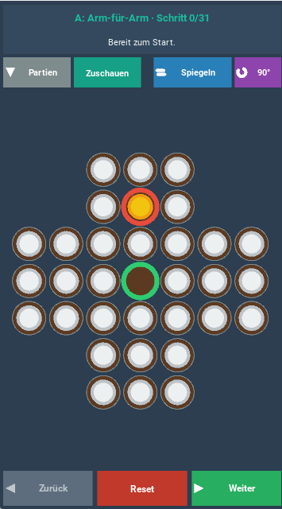

# Kreuz-Solitär

Das klassische Solitär-Brettspiel mit 33 Feldern in Kreuzform als Android-App (und am PC), gebaut mit Kivy.

Ziel: Durch Überspringen alle Steine bis auf einen entfernen. Perfekt ist es, wenn der letzte Stein in der Mitte liegt.

## Funktionen

- **Spielen:** Stein antippen, dann das Zielfeld antippen. Zurück nimmt einen Zug zurück, Neu startet eine neue Partie.
- **Zuschauen:** Vier mitgelieferte Lösungen (A: Arm-für-Arm, B: Kreuz-Flanken, C: Chaos-Weg, D: Karo-Lösung), Schritt für Schritt mit Weiter und Zurück. Die Lösung lässt sich spiegeln oder um 90° drehen.
- **Weiterspielen:** Im Zuschauen-Modus an beliebiger Stelle auf Spielen wechseln und ab dort selbst weiterspielen.
- **Partienliste:** Alle eigenen Partien werden automatisch gespeichert (Datei `solitaer_partien.json`). Öffnen und Löschen (mit Rückfrage) über die Liste.
- Dreht in alle Bildschirmrichtungen.

## Installation (Android)

1. Unter **Releases** (rechts auf der Startseite) die neueste `kreuzsolitaer.apk` herunterladen.
2. Die Datei auf dem Handy öffnen und installieren. Dazu in den Android-Einstellungen „Unbekannte Quellen“ erlauben.

Alternativ liegt jede Version auch unter **Actions**: neuesten grünen Lauf öffnen, unten bei **Artifacts** `kreuz-solitaer-apk` herunterladen und die ZIP-Datei entpacken.

Es handelt sich um eine Debug-APK für den privaten Gebrauch.

## Am PC starten

    pip install kivy
    python main.py

## Selbst bauen

Der Bau läuft automatisch über GitHub Actions (`.github/workflows/build-apk.yml`) mit Buildozer und python-for-android. Jeder Push auf `main` startet einen Lauf, oder von Hand über Actions → Build Android APK → Run workflow. Der erste Lauf dauert etwa 20–25 Minuten, spätere sind schneller. Einstellungen stehen in `buildozer.spec`.

## Dateien

- `main.py` – die komplette App
- `buildozer.spec` – Android-Bau-Einstellungen
- `.github/workflows/build-apk.yml` – automatischer APK-Bau
